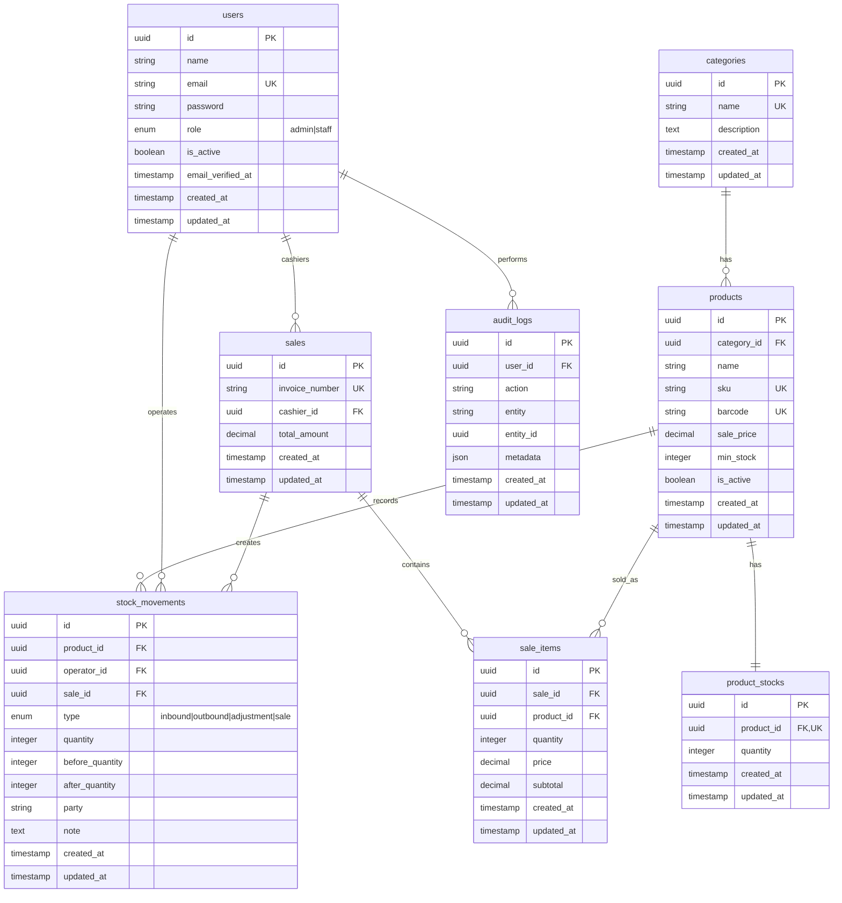

# ERD TuneBoss Inventory Backend

ERD ini mengikuti PRD backend TuneBoss Inventory dengan stack Laravel + MariaDB/MySQL. Struktur dibuat untuk kebutuhan fase awal: autentikasi, kategori, produk, stok masuk/keluar, penjualan sederhana, dashboard, laporan JSON, dan audit log.

## Mermaid ERD

## Catatan Relasi

- `users.role` cukup menggunakan enum `admin` dan `staff` untuk fase awal, belum perlu tabel `roles` terpisah.
- `products.category_id` wajib ada agar produk bisa difilter berdasarkan kategori.
- `product_stocks.product_id` dibuat unique karena satu produk hanya punya satu snapshot stok saat ini pada fase awal.
- `stock_movements` adalah ledger perubahan stok dan wajib dibuat setiap ada inbound, outbound, adjustment, atau sale.
- `product_stocks.quantity` adalah snapshot untuk dashboard dan lookup cepat, bukan pengganti ledger.
- `sales` menyimpan transaksi penjualan, sedangkan detail barang ada di `sale_items`.
- `sales` dapat menghasilkan beberapa `stock_movements` type `sale`, satu movement per produk yang terjual.
- `audit_logs` menyimpan aktivitas penting seperti login gagal, tambah produk, edit stok, hapus kategori, dan koreksi stok.

## Index Yang Disarankan

- `users.email` unique.
- `categories.name` unique.
- `products.sku` unique.
- `products.barcode` unique nullable.
- `products.category_id` index.
- `products.is_active` index.
- `product_stocks.product_id` unique.
- `stock_movements.product_id` index.
- `stock_movements.operator_id` index.
- `stock_movements.type` index.
- `stock_movements.created_at` index.
- `sales.invoice_number` unique.
- `sales.cashier_id` index.
- `sales.created_at` index.
- `sale_items.sale_id` index.
- `sale_items.product_id` index.
- `audit_logs.user_id` index.
- `audit_logs.entity` index.
- `audit_logs.created_at` index.

## Business Rules Database

- SKU wajib unik.
- Barcode wajib unik jika diisi.
- Stok tidak boleh negatif.
- Outbound dan sale wajib gagal jika stok tidak cukup.
- Semua update stok wajib dilakukan dalam database transaction.
- Produk yang sudah dipakai transaksi sebaiknya dinonaktifkan, bukan dihapus permanen.
- Kategori tidak boleh dihapus jika masih dipakai produk.
