# Flowchart TuneBoss Inventory Backend

Flowchart ini mengikuti PRD backend TuneBoss Inventory dengan target Laravel API + MariaDB/MySQL dan frontend Expo/React Native.

## Arsitektur Integrasi

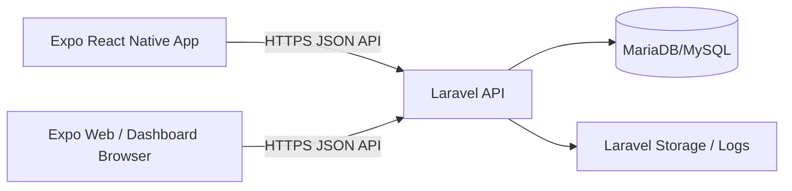

## Flow Login

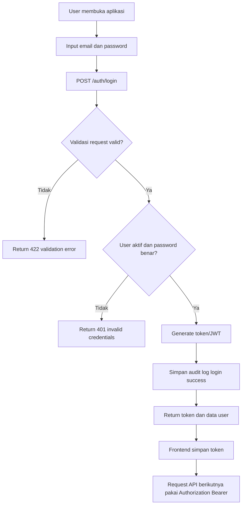

## Flow Dashboard

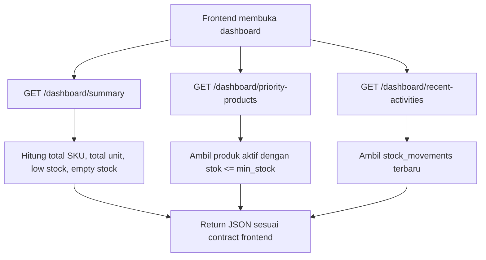

## Flow CRUD Kategori

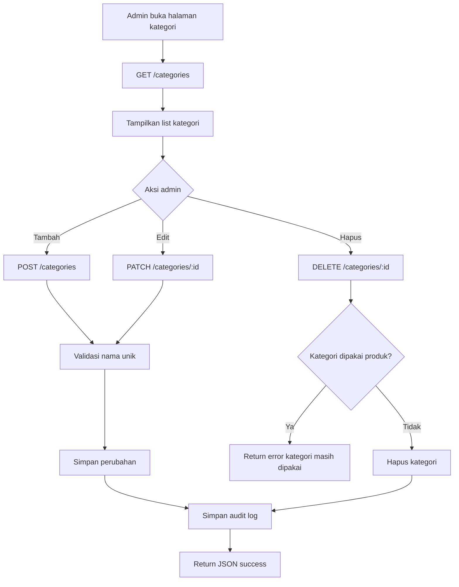

## Flow CRUD Produk

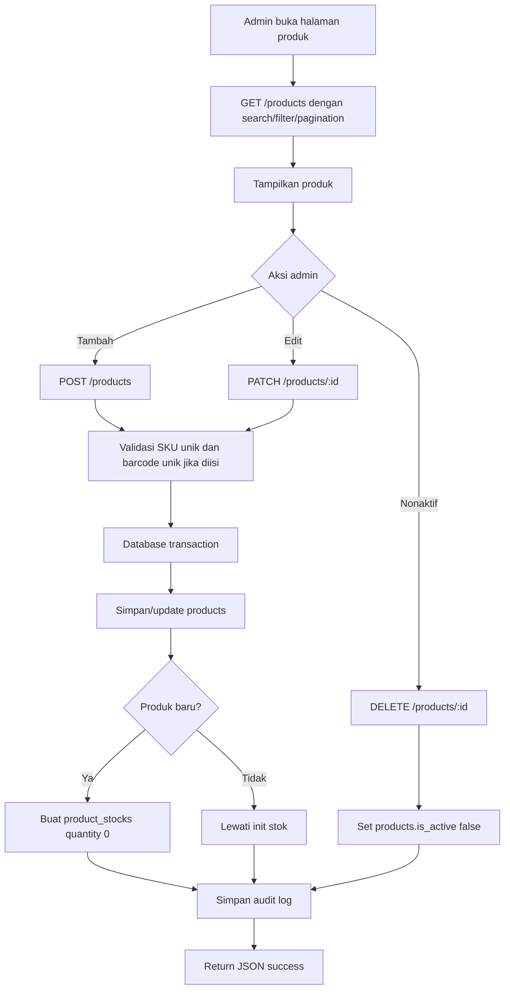

## Flow Lookup Barcode/SKU

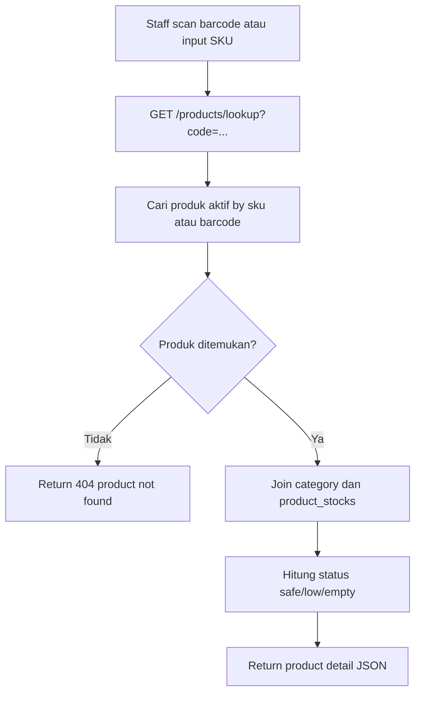

## Flow Stok Masuk

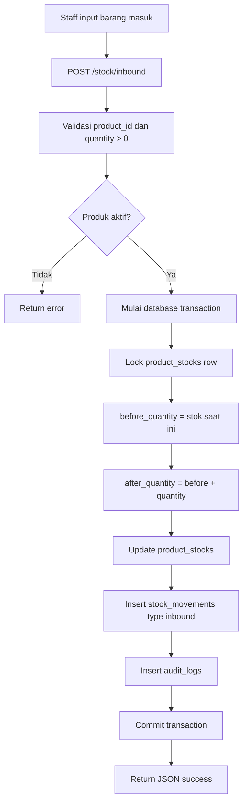

## Flow Stok Keluar

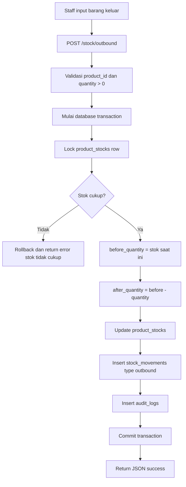

## Flow Koreksi Stok

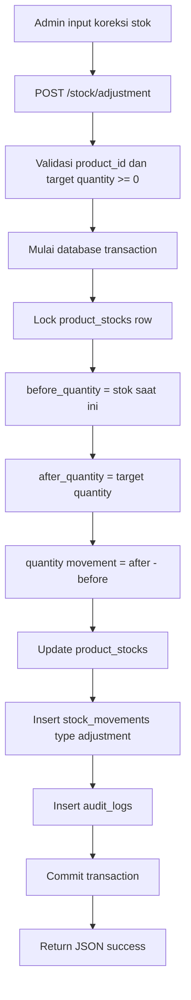

## Flow Penjualan

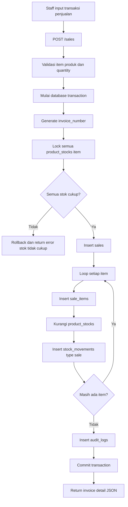

## Flow Laporan

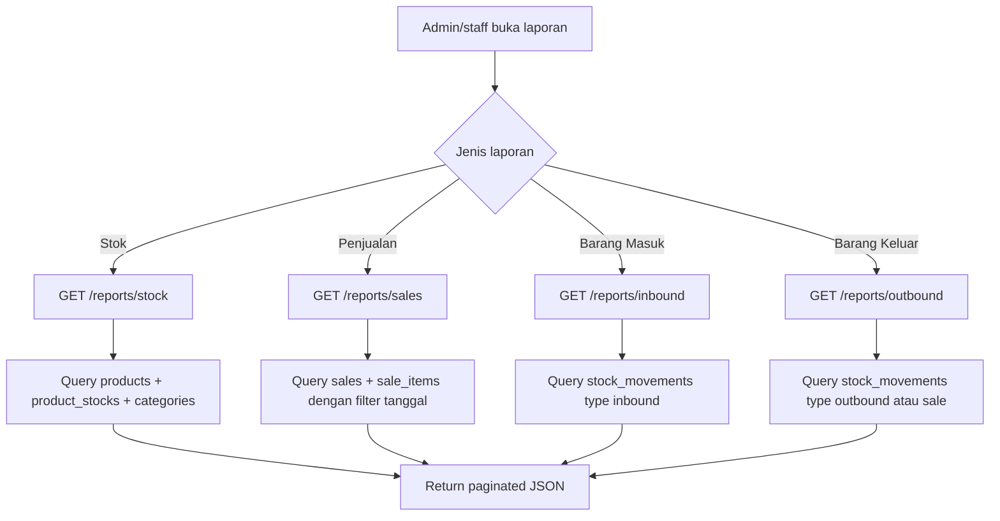

## Flow Role Access

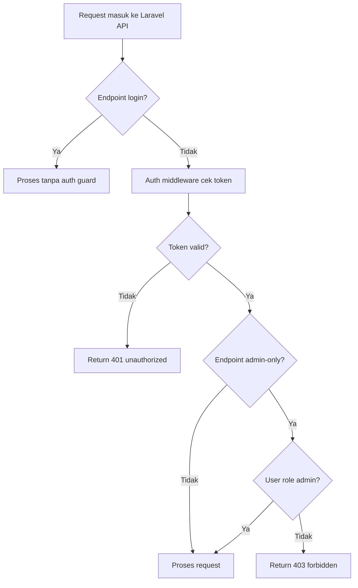

## Mapping Flow Ke Frontend Saat Ini

- Dashboard frontend mengambil data dari `GET /dashboard/summary`, `GET /dashboard/priority-products`, dan `GET /dashboard/recent-activities` untuk menggantikan dummy data di `src/data/dashboard.data.ts`.
- Halaman kategori memakai endpoint `/categories`.
- Halaman stok/data barang memakai endpoint `/products` dan `/products/lookup`.
- Halaman scan memakai endpoint `/products/lookup?code=...`.
- Halaman barang masuk memakai endpoint `POST /stock/inbound`.
- Halaman barang keluar memakai endpoint `POST /stock/outbound`.
- Halaman penjualan memakai endpoint `POST /sales` dan `GET /sales`.
- Halaman laporan memakai endpoint `/reports/stock`, `/reports/sales`, `/reports/inbound`, dan `/reports/outbound`.
